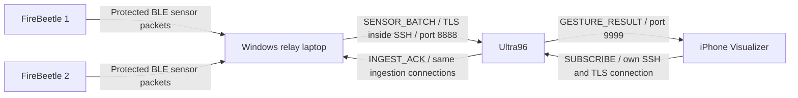
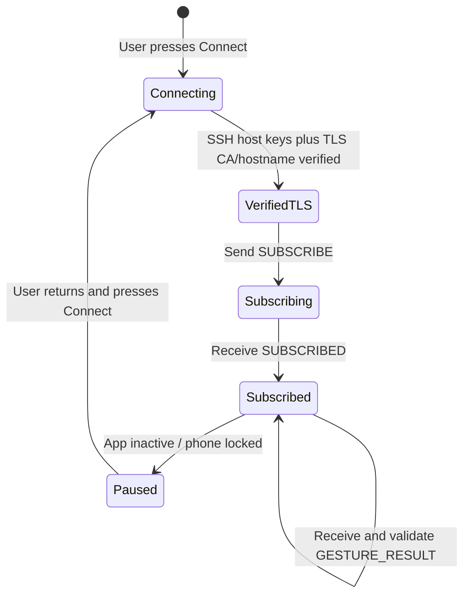
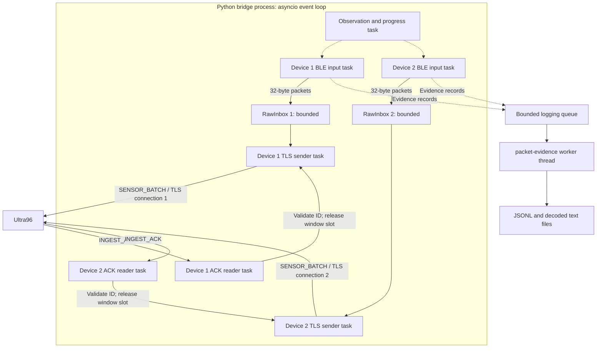
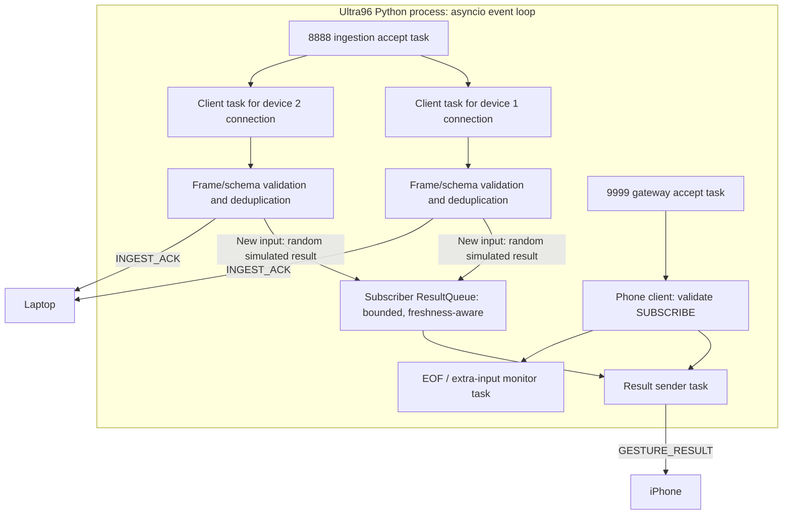

# B07 CO 视频演示稿：仅覆盖标有 Video 的要求

> **已更新为两个文件。** 请使用 [投屏图解与英文解释](D:/LetThemCook/docs/B07-CO-video-visuals.en.html) 和 [手机拍摄＋电脑录屏操作稿](D:/LetThemCook/docs/B07-CO-video-operator-script.zh-CN.md)。下方旧稿保留参考；拍摄顺序及烧录安排以新的操作稿为准：手机先拍同一台 Windows 电脑上的 USB 烧录和 ID/包格式检查，随后拔掉 USB、独立供电并拍通信现象，再用电脑录屏讲解图和源码。

适用项目：`D:\LetThemCook`。依据：老师提供的 guideline、当前仓库代码，以及 2026-09-28 的 CO v2 部署记录。

**用法：中文部分指导你操作，英文引用块可以直接口播。预计成片约 10–12 分钟，时长是建议，不是老师规定。** `[N1]`、`[N2]`、`[P0]`、`[P1]` 必须用本次录制实际观察到的数值替换。

本稿按当前 **v2 随机 dummy 数据 + 两块实体 FireBeetle + Windows relay laptop + 实体 Ultra96 + 原生 iPhone/Unity Visualizer** 编写。本文的“预期结果”是录制时的检查标准；编写本文时没有重新运行实体通信测试。

**录制顺序速查：照顺序做，完整台词在对应章节。**

| 顺序 | 你正在做什么 | 镜头必须拍到 | 去哪里看详细稿 |
|---|---|---|---|
| 录制前 | 确认固件/服务/手机版本、VPN、两份独立电源；打开源码标签页 | 这部分先准备好 | 第 2–3 节、附录 A/B |
| 1 | 介绍设备；展示固件 ID 配置；运行两条 pairing 检查 | 两块板子无 relay USB、ID 1/2、两条认证绑定结果 | 第 3–4 节 |
| 2 | 解释随机 fixtures、32-byte 包、控制类型和 BLE FSM | 数据表、实际代码、FSM 图 | 第 5 节 |
| 3 | 终端 A 启动隧道；手机先 Connect；终端 B 运行 60 秒采集 | `Subscribed` 起始计数、两路接收与 ACK 增长 | 第 6 节 |
| 4 | 在**同一次采集**中拍手机结果；结束后看报告/日志 | 手机最终计数、实际 values/seq、报告与增量相符 | 第 7 节 |
| 5 | 打开三条通道的安全代码，逐段讲解 | BLE 安全配置、Python TLS、手机 TLS/SSH 校验 | 第 8 节 |
| 6 | 先看两张并发框图，再看任务/队列代码；结尾 | Laptop 和 Ultra96 的任务、数据交换与依赖 | 第 9–10 节 |

**读稿规则：** 中文是操作指令，`>` 引用块是英文口播；“预期结果”必须在本次实测出现后才能作为成功结论说出来。附录是准备/被问到时的操作，不需要全文念出。

## 1. 本次视频的范围

| 老师原要求 | 本稿录制内容 | 对应段落 |
|---|---|---|
| 1. Laptop ↔ Ultra96 `[Live + Video]` | 协议、FSM、真实链路发送 dummy 包及接收 ACK | 第 6 段 |
| 2. Ultra96 ↔ phone Visualizer `[Live + Video]` | 协议、FSM、手机订阅与接收结果 | 第 7 段 |
| 3. FireBeetle setup `[Video only]` | 板子、ID、固件配置、供电、认证绑定 | 第 4 段 |
| 4. Explain FireBeetle: IDs/types/format `[Live + Video]` | 设备 ID、传感器包及控制包格式、双向通信含义 | 第 5 段 |
| 6. Encryption walkthrough `[Video only]` | BLE、laptop–Ultra96、Ultra96–phone 三条通道的源码 | 第 8 段 |
| 7. Concurrency/threading walkthrough `[Video only]` | Laptop 与 Ultra96 的并发框图、源码和数据交换 | 第 9 段 |

按你“只有后面有 video 的”的范围，本稿不安排一分钟鲁棒性考核、kbps/最高速测试、断电/超距测试，或第 5 项键盘完整 pipeline 的单独演示。第 4 项未单独标注 Video 的文件传输等内容也不列为必录。仍使用两块板子运行，便于展示现有程序和并发关系；这不替代 Live 部分的最高速验收。

General Guidelines 中与视频有关的要求仍适用：使用实际协议格式的随机 dummy 包、用 FSM 解释协议、用框图解释并发、终端清晰且区分两路颜色，以及 FireBeetle 独立供电。

### 通用准则逐条对照

| General Guideline | 本稿具体怎么落实 |
|---|---|
| 1. Dummy Data | 第 5 节展示真实结构和多组随机 fixtures；附录 B2 准备老师临时要求的修改→生成→重编译/上传→重新运行→检查新值流程。此条是被要求时必须能操作的能力，不把它误写成 Live only 的键盘 pipeline。 |
| 2. Threads/Concurrency | 第 9 节有两张框图，画明队列、传输数据和 ACK 窗口依赖，并定位 `create_task` / 日志线程。 |
| 3. Decluttering Display | 两个设备分色、每秒进度、抽样解码输出；第 7 节再打开保存的可读日志，避免滚动刷屏掩盖结果。 |
| 4. Video Recording | 第 5–7 节展示三张 FSM；第 8–9 节源码放大并按函数定位。PPT 是可选展示方式，不是额外强制提交物。 |
| 5. Powering FireBeetles | 第 4 节拍两个独立电源和无 relay laptop USB 连接；选择不会因低电流关机的电源。 |
| 6. Source Code | 第 8–9 节讲有注释的安全/队列/任务代码，录前检查这些注释在放大画面中可读；不展示整页密集代码。 |
| 7. Packet format/logs | 第 5 节列结构；第 7 节打开本次 `packets.log` 指出身份、序号和通道值。当前应用包无 CRC 字段，如实说明。 |
| 8. TCP fragmentation | 第 6 节展示长度前缀及两次 `readexactly`，明确 TCP 不保留消息边界。 |
| 9. Data Broker | 本项目不使用 MQTT 等 data broker；业务服务器在 Ultra96，电脑只运行客户端桥接和回环 SSH 转发入口。 |
| 10. Relay Laptop | 说明 TCP 业务服务器在 Ultra96；本部署通过校园跳板访问板端回环服务，所以使用 SSH 本地转发。这是当前网络路径，不把隧道说成 TCP 协议本身的必需条件。 |

## 2. 到底要运行哪些文件

### 2.1 运行清单

| 在哪里 | 文件/程序 | 怎么运行 | 是否需要在镜头中启动 |
|---|---|---|---|
| Windows 终端 A | `D:\LetThemCook\demo.py` | `python demo.py tunnel` | 建议；密码输入过程可剪掉 |
| Windows 终端 B | 同一个 `demo.py` | `python demo.py run --duration 60 --rate 10` | 是，正式数据演示入口 |
| Windows 终端 B | 同一个 `demo.py` | `python demo.py report` | 是，显示本次摘要 |
| Windows 录制前 | `laptop.windows_pairing` 模块 | 两条检查命令见第 4 段 | 可拍到认证绑定检查结果 |
| Windows，由 launcher 自动启动 | `D:\LetThemCook\laptop\dual_bridge.py` | `demo.py run` 自动调用 | 不用另开一个实例 |
| Ultra96 | 已部署的 `ultra96.server` 模块 | 已运行时复用；没运行时看附录 A | 不必每次重启；可拍端口/进程检查 |
| 两块 FireBeetle | 由 `firmware\esp32\src\main.cpp` 编译的固件 | 上电自动执行 | 拍外接电源与上电即可 |
| iPhone | 已安装且支持 v2 的 Unity 应用 | Week 7 Connect / Settings → Connect | 是，拍 `Subscribed` 和结果 |

**正式录制的三条核心命令：**

终端 A：

```powershell
Set-Location 'D:\LetThemCook'
python demo.py tunnel
```

终端 B，手机订阅成功后：

```powershell
Set-Location 'D:\LetThemCook'
python demo.py run --duration 60 --rate 10
```

等上一条自然结束，再运行：

```powershell
python demo.py report
```

`--rate 10` 会向两块板子设置每秒 10 个传感器包的目标发送速率，避免沿用之前的测速设置。此处只做通信展示，不以输出中的速率字段宣称最大速度。

### 2.2 只打开讲解，不需要单独执行的源码

提前在编辑器打开这些标签页，字号建议 22–26 px，每次只显示约 20–30 行：

| 用途 | 打开的文件 | 搜索定位 |
|---|---|---|
| 固件/设备 ID | [platformio.ini](D:/LetThemCook/firmware/esp32/platformio.ini) | `firebeetle32-left`、`firebeetle32-right` |
| 随机 dummy 数据 | [dummy_fixtures.json](D:/LetThemCook/common/dummy_fixtures.json) | 四组八通道样本 |
| BLE 包格式 | [sensor.py](D:/LetThemCook/common/sensor.py:11) | `_PACKET`、`decode_packet`、`to_message` |
| BLE 安全/发送 | [main.cpp](D:/LetThemCook/firmware/esp32/src/main.cpp) | `ESP_LE_AUTH_REQ_SC_MITM_BOND`、`onAuthenticationComplete`、`serializeFixturePacket` |
| TCP 分帧 | [wire.py](D:/LetThemCook/common/wire.py) | `encode_frame`、`read_frame` |
| Python TLS | [tls.py](D:/LetThemCook/common/tls.py:7) | `client_context`、`server_context` |
| Laptop 任务创建 | [dual_bridge.py](D:/LetThemCook/laptop/dual_bridge.py:94) | `writers`、`inputs` |
| Laptop 队列与 ACK | [bridge.py](D:/LetThemCook/laptop/bridge.py) | `RawInbox`、`_connect_tls`、`_pipeline_epoch` |
| 板端接收/订阅 | [server.py](D:/LetThemCook/ultra96/server.py) | `start`、`_accept`、`_ingest`、`_gateway` |
| 手机 TLS | [Week7Client.swift](D:/LetThemCook/ios-visualizer/Week7Native/Sources/Week7Transport/Week7Client.swift:89) | `trustRoots`、`certificateVerification`、`NIOSSLClientHandler` |
| 手机 SSH 信任 | [Trust.swift](D:/LetThemCook/ios-visualizer/Week7Native/Sources/Week7Transport/Trust.swift:4) | `PinnedHostKey` |
| 真正的日志线程 | [evidence.py](D:/LetThemCook/laptop/evidence.py:33) | `threading.Thread`、`put_nowait` |

## 3. 录制前准备与开场（00:00–00:30）

### 录制前完成

1. 确认两块 ESP、Ultra96 服务和 iPhone 应用都为匹配的 v2 版本。9 月 28 日部署报告记载已完成更新及一次 iPhone 总计数检查；录制当天仍以实际运行结果为准。
2. Windows 和 iPhone 开启所需 VPN；Windows 蓝牙开启。
3. 关闭其他连接这两块 ESP 的 BLE 客户端。手机作为本次唯一结果订阅者；不要同时运行 `phone.receiver`、`laptop.phone_simulator` 或带桌面结果订阅器的 rehearsal。板端新订阅者会替换旧订阅者。
4. 确认 Ultra96 服务和电脑隧道情况；复用已确认属于本项目的正常实例。附录 A 有板端检查方法。
5. 两块 FireBeetle 使用两个独立电源。正式演示时，**两块都不能用 USB 连接 relay laptop**，即使另有电源也应拔掉该 USB 线。使用不会因低电流自动关机的充电宝，或独立供电电脑。
6. 摆好画面：屏幕录制电脑终端/源码，另一镜头拍手机和硬件；保证最后能清楚读出手机计数。遮住密码、配对口令和私钥内容。
7. 检查要展示的源码注释清晰可读；提前打开 Mermaid 图的渲染预览，录图形本身，不把 Mermaid 源文本当作框图展示。没有预览时可依照图中节点/箭头放到 PPT 中。

### 开场画面

拍两块板子、relay laptop、iPhone；用下面的数据流图说明 Ultra96 的位置。



**口播：**

> This video demonstrates B07's communication subsystem. Two FireBeetles send structured dummy sensor packets to the relay laptop over protected Bluetooth Low Energy. The laptop forwards them to Ultra96, which returns ingestion acknowledgements and sends simulated gesture results to the iPhone. I will show the setup, packet formats, successful communication, encryption, and concurrency.

## 4. FireBeetle setup（00:30–01:40）

**对应要求：第 3 项 Video only。**

### 操作与画面

1. 拍板子标签“1 / left”“2 / right”和各自电源，展示它们没有 USB 连接 relay laptop，然后通电。
2. 打开 `platformio.ini`，指出 `board = firebeetle32`、`framework = arduino` 和两个环境的 `WEEK7_DEVICE_ID=1/2`。
3. 说明固件已预先编译烧录；若要拍首次烧录片段，按附录 B 使用**另一台编程电脑**，保持板子不通过 USB 连接 relay laptop。
4. 终端 B 运行现有绑定检查：

```powershell
Set-Location 'D:\LetThemCook'
python -m laptop.windows_pairing --address 38:18:2B:19:82:AE
python -m laptop.windows_pairing --address 38:18:2B:18:9D:6A
```

### 应观察到什么

| 设备 | 当前 BLE 地址 | 应用 ID | 预期检查结果 |
|---|---|---|---|
| Left | `38:18:2B:19:82:AE` | `device_id=1` | `authenticated_bond: true` |
| Right | `38:18:2B:18:9D:6A` | `device_id=2` | `authenticated_bond: true` |

地址用于找到硬件；包里的 `device_id` 用于应用层识别，二者不是同一个字段。绑定检查成功说明认证绑定存在；后面的采集还要证明能连接、订阅受保护特征并收到通知。

**口播：**

> These are our two FireBeetle ESP32 boards. The left firmware uses device ID one, and the right firmware uses device ID two. They run the Arduino firmware configured for the FireBeetle board. Both are powered independently, with no USB connection to the relay laptop during this demonstration.
>
> The firmware was uploaded and authenticated pairing was completed before recording. These checks show an authenticated bond for each device. The BLE addresses select the physical boards, while the device IDs inside the packets identify their application data. The bridge will establish the active connections and subscribe to notifications next.

## 5. Device IDs、包类型、包格式与 BLE FSM（01:40–03:20）

**对应要求：第 4 项中明确标有 Live + Video 的说明部分。**

### 5.1 传感器数据包

打开 `common/sensor.py`，指向 `struct.Struct("<2sBBIII8h")`；然后展示这张表。

| 偏移（byte） | 长度 | 字段 | 解释 |
|---|---:|---|---|
| 0–1 | 2 | Magic `W7` | 识别传感器包 |
| 2 | 1 | Version | 当前固件默认发 `2` |
| 3 | 1 | Device ID | `1` 或 `2` |
| 4–7 | 4 | Boot ID | 区分不同启动实例 |
| 8–11 | 4 | Sequence | 当前启动下的传感器样本序号 |
| 12–15 | 4 | Uptime ms | 板子启动后的毫秒数 |
| 16–31 | 16 | Values | 八个有符号 int16 通道 |

总计 **32 bytes**；多字节整数为 **little-endian**。`device_id + boot_id + seq` 标识一个传感器样本。这里是模拟传感器通道，不应说成已接入真实 IMU 或已完成真实 AI 推理。

打开 `common/dummy_fixtures.json`，指出当前四组八通道数据。固件从中随机选择，包头、ID、时间戳和字段类型仍符合实际协议。随机意味着允许重复，不保证每四个包恰好各出现一次。

随后在 `main.cpp` 的 `loop()` 中定位 `serializeFixturePacket` 和选取 fixture 的调用，让观众看到随机数据确实用于发送。老师临时要求修改 dummy 数据时，按附录 B2 完整操作；应在录制前熟悉这套流程，而不是只会改屏幕中的示例数字。

### 5.2 双向通信与包类型

| 方向/层次 | 包或消息类型 | 在本系统的作用 |
|---|---|---|
| ESP → laptop | `W7` 传感器包 | 独立 characteristic 的 BLE notification；没有另加一个 opcode 字段 |
| Laptop 读取 ESP | `W7S1` 源端计数 | 24-byte 受保护 Read characteristic；包含设备/启动身份、下一序号、成功提交及失败计数，支持最后对账 |
| Laptop → ESP → laptop | `B7` 控制请求/响应 | GATT 写入和响应通知；用于 command、rate、file 控制 |
| Laptop → Ultra96 | `SENSOR_BATCH` | 结构化 JSON 承载解码后的样本 |
| Ultra96 → laptop | `INGEST_ACK` | 确认接入，状态为 `accepted` 或 `duplicate` |
| Phone → Ultra96 → phone | `SUBSCRIBE` / `SUBSCRIBED` | 建立结果订阅，订阅 envelope 仍为 v1 |
| Ultra96 → phone | `GESTURE_RESULT` | 当前 v2 模拟 gesture 和可追踪 result ID |

`B7` 控制头是 **14 bytes，格式 `<2sBBBBII>`**：Magic 2 + version 1 + opcode 1 + device 1 + status 1 + request/transfer ID 4 + offset 4。控制协议版本为 1，与传感器包 v2 分开编号。Opcode：`0x01` command、`0x02` rate、`0x10–0x13` file begin/chunk/end/abort；响应将 opcode 的 bit 7 置为 1。控制 payload 随类型变化，command payload 是完整的 32-byte v2 传感器包。

v2 的 `SENSOR_BATCH`、`INGEST_ACK`、`GESTURE_RESULT` 都包含 `request_id`：连续传感器流为 `null`，command 为非零请求 ID，且 command 的 `seq == request_id`。订阅消息 `SUBSCRIBE/SUBSCRIBED` 仍为 v1，不能把三套版本号混用。

本次 `--rate 10` 使用 rate 控制请求与响应。若老师问 command 语义：ESP 将八个通道各加一，int16 最大值回绕，并更新 uptime；电脑验证响应后才能转发。本视频无需额外录制键盘完整 pipeline。

### 5.3 用 FSM 解释 BLE 协议

下面是应用协议行为的概括图，不代表源码里存在同名的 enum。

```mermaid
stateDiagram-v2
    [*] --> Advertising: ESP powered on
    Advertising --> Securing: Laptop connects
    Securing --> Ready: Authenticated encrypted peer
    Securing --> Advertising: Authentication fails / disconnect
    Ready --> Streaming: Sensor notifications enabled; ATT MTU >= 35
    Streaming --> Streaming: Send 32-byte sample at configured rate
    Streaming --> Advertising: Disconnect; laptop retries
    Ready --> Advertising: Disconnect
```



只传 32-byte sensor notification 需要 ATT MTU 至少 35；本稿的 `--rate 10` 还用到控制通道，因此本次连接要求 **ATT MTU ≥64**。历史实测为 517，不把它当作每次都必然协商出的值。

**口播：**

> The sensor packet is thirty-two bytes long. It contains the W7 marker, protocol version, device ID, boot ID, sequence number, uptime, and eight signed sixteen-bit sensor values. Multi-byte fields use little-endian encoding. The device, boot and sequence fields identify each sample.
>
> Version two randomly selects from multiple editable dummy fixtures while preserving this packet format. The data is structured sensor data, not a plain integer or text string. Control requests use a separate B7 header with an opcode and request ID. Responses set the response bit, allowing the laptop to correlate them with requests.
>
> This state machine shows advertising, connection security, readiness, and streaming. Notifications start only when the protected connection, subscription and MTU requirements are met. After disconnection, the firmware advertises again and the laptop attempts to reconnect.

## 6. Laptop ↔ Ultra96：协议和成功通信（03:20–05:10）

**对应要求：第 1 项 Live + Video。**

### 6.1 先解释 TCP、TLS 与分帧

画面展示 `common/wire.py` 的 `encode_frame()` 和 `read_frame()`：

```text
Application frame = 4-byte unsigned big-endian JSON byte length + UTF-8 JSON
Allowed JSON body size = 1..16384 bytes

readexactly(4) → decode length → readexactly(length) → validate JSON/schema
```

提醒自己：**BLE 包内整数为 little-endian；TCP 帧的 4-byte 长度为 big-endian**。这里不能说“调用一次 recv 就拿到一个完整包”。

```mermaid
stateDiagram-v2
    [*] --> Connecting
    Connecting --> VerifiedTLS: SSH route ready; CA and hostname verified
    Connecting --> Closing: Connect / TLS handshake failure
    VerifiedTLS --> Active: Connection ready
    Active --> Active: Send SENSOR_BATCH; validate correlated INGEST_ACK
    Active --> Closing: Timeout / invalid ACK / transport error
    Closing --> Connecting: Close failed connection; bounded retry
    Active --> Finished: Stop input; drain; close
    Finished --> [*]
```



这是连接生命周期；`Active` 内发送和收 ACK 可同时推进，每台最多有 32 个在途消息，不是逐包等 ACK 后才发下一包。

**口播：**

> The laptop sends SENSOR_BATCH messages to Ultra96 and receives correlated INGEST_ACK messages. This is TCP with TLS, carried through an SSH tunnel to the board's ingestion service on port eight-eight-eight-eight.
>
> TCP is a byte stream, so a message can arrive in several chunks. Our application prefixes each JSON message with a four-byte big-endian length. The receiver reads exactly four bytes for the header and then exactly the declared body length. It also enforces a size limit and validates the message schema.

**指向架构图，补充一句网络部署说明：**

> The application servers run on Ultra96, and we do not use a message broker. SSH forwarding is used for our deployed campus access route; it is not a requirement of TCP itself.

### 6.2 实际运行

1. 终端 A 输入 `python demo.py tunnel`，完成认证后保持打开。隧道将电脑 `127.0.0.1:18889` 转发至 Ultra96 `127.0.0.1:8888`。已有正确隧道时可直接拍它并复用。
2. **先连接手机**：Unity → Week 7 Connect / Settings，保持 **Use campus jump host** 开启，使用已导入的可信公开 CA，填写 Board / Jump 登录信息后 Connect。等待 `Subscribed, Received: 0`，或记录已有订阅的起始计数 `[P0]`。先订阅可避免启动时的结果无人接收；手机不连接电脑的 `18889` 端口。
3. 终端 B 输入：

```powershell
python demo.py run --duration 60 --rate 10
```

4. 让程序自然结束；正式 observation 为 60 秒，连接与收尾会增加总耗时。不要中途 Ctrl+C。
5. 等待期间拍终端中两路 progress 和抽样的已解码记录；用接下来的口播解释它们。

### 6.3 应观察到什么

- `mode=physical`，且两台都进入 `phase=observation`。
- `device=1`、`device=2` 的 `received`、`acked` 在同一运行中持续增长；终端通常以青色/紫色区分两路，保存的日志为普通文本。
- 已解码 `sensor` 行显示 `device_id`、`boot_id`、`seq` 和 values；`sensor_ack` 行显示对应身份与确认状态，便于把发送样本与 ACK 对起来。
- 正常演示期间 `drops=0`、`errors=0`。运行中 `received` 和 `acked` 可短暂不同，最终看排空后的报告。

示意格式，**不是本次真实输出**：

```text
progress mode=physical phase=observation device=1 received=100 processed=100 acked=98 ... drops=0 errors=0 ...
progress mode=physical phase=observation device=2 received=100 processed=100 acked=99 ... drops=0 errors=0 ...
```

**看到实际递增后口播：**

> The bridge is now receiving both physical BLE streams. The received counters show packets arriving at the laptop. The acknowledged counters increase when Ultra96 returns a valid acknowledgement with matching identifiers. Both devices are progressing during the same capture, and the decoded records show the sensor values and sequence information.

## 7. Ultra96 ↔ 手机：订阅、结果和对账（05:10–06:30）

**对应要求：第 2 项 Live + Video。使用上一段同一次运行，同时把镜头转向手机。**

### 协议与画面

1. 拍手机的 `Subscribed` 状态、`Received` 增长和 gesture/result ID。保持应用前台，不锁屏，不再次 Connect。
2. 指出结果为随机模拟的 `REST / FIST / OPEN / POINT`，不是已训练模型输出。标签允许连续重复。
3. 拍到结果 ID 中的设备号；传感器结果形如 `1:<boot>:<seq>` 或 `2:<boot>:<seq>`。它包含已在 laptop 记录中出现的身份字段；界面刷新可能只显示最新结果，不要求每个包都单独留屏。
4. 等采集结束和手机计数稳定后，终端 B 执行 `python demo.py report`，同时拍手机最终计数 `[P1]`。
5. 根据 `Saved in:` 打开**本次目录**的 `packets.log`，搜索一行 `type=sensor` 和同一设备/boot/seq 的 `type=sensor_ack`。把 `device_id`、`seq`、`values` 与对应确认状态留在可读画面中约 5 秒。只显示相关几行，不快速滚动整份日志。

**展示日志时口播：**

> The saved log decodes the packets into readable device IDs, sequence numbers and sensor values. This acknowledgement refers to the same device, boot and sequence as the sensor packet.



这是正常订阅及应用暂停路径；网络错误另由客户端按错误类别处理重试或要求重新连接。视频无需额外做断网/锁屏测试。

### 明确的成功标准

| 观察位置 | 本次应看到 |
|---|---|
| 电脑摘要 | `Exit=0`、`clean=True`、`mock_input=False`、`report_saved=True` |
| 设备 1 | `Generated = Received = ACKed = [N1]`，MissingBLE / MissingACK 都是 0 |
| 设备 2 | `Generated = Received = ACKed = [N2]`，MissingBLE / MissingACK 都是 0 |
| Launcher | `CAPTURE PASSED` 和 `Phone expected increase: [N1+N2]` |
| 手机 | `[P1] - [P0] = [N1] + [N2]`；本稿主命令没有键盘 command 结果 |

**不要预先写死 1200。** 启动/收尾计入的样本可能使源端总数超过 60 秒 × 10 Hz × 2。若另加了 keyboard 命令，手机预期还需加成功完成的 command 数；以 launcher 的实际输出为准。

停止发送约两秒后，手机显示 `No live result` 是最新结果过期，不代表刚才的接收计数失效。

**口播：**

> The phone has its own SSH and TLS connection to Ultra96's result service on port nine-nine-nine-nine. It sends SUBSCRIBE and receives SUBSCRIBED before listening for GESTURE_RESULT messages. Results travel directly from Ultra96 to the phone. They are not relayed back through the laptop.
>
> The phone's count is increasing, and the displayed result IDs identify the source device, boot and sequence. Ultra96 randomly chooses a simulated gesture for each new accepted version-two input.

**只有对账通过后，才读这一段并填入实际数字：**

> Device one generated [N1] packets and device two generated [N2]. For each device, the generated, received and acknowledged counts match. The phone count increased from [P0] to [P1], matching the combined total. This demonstrates successful ingestion and matching aggregate reception on the phone during this capture.

**如果失败，使用这段并停止宣称成功：**

> This capture did not meet the acceptance checks. The report and phone count show the mismatch, so I will investigate it and make a new capture before claiming a successful demonstration.

板端 ACK 证明接入；手机增量证明本次观察到的总接收数。总数相等本身不是逐条手机 result ID 审计。本稿不把两者混为同一种证据。

## 8. 三条通道的加密源码讲解（06:30–09:00）

**对应要求：第 6 项 Video only。每条通道都要打开源码，不能只说一句“用了加密”。**

### 8.1 FireBeetle ↔ laptop：BLE 链路保护（约 50 秒）

**画面顺序：**

1. `firmware/esp32/src/main.cpp` 搜索 `ESP_LE_AUTH_REQ_SC_MITM_BOND`，指出 Secure Connections、MITM 和 bonding 配置。
2. 搜索 `ESP_GATT_PERM_READ_ENC_MITM` / `ESP_GATT_PERM_WRITE_ENC_MITM`，指出受保护 GATT 属性/CCCD；展示其中一个明确例子即可。
3. 搜索 `onAuthenticationComplete` 中的 `currentPeer`，说明认证结果只用于当前连接；再展示 `week7_security.h` 的 `canNotify` / `canAcceptControl`，说明通知和控制操作的门槛。
4. `laptop/bridge.py` 的 `ble_loop()` 中搜索 `require_authenticated_bond`，对应刚才的绑定检查。

**口播：**

> The FireBeetle link uses authenticated BLE Secure Connections with bonding and man-in-the-middle protection. These GATT permissions require authenticated encryption, and the firmware checks the current peer before allowing protected operations. The laptop also requires an authenticated bond.
>
> Encryption is provided by the Bluetooth stack. We do not implement a separate application encryption function for each sensor packet. The thirty-two-byte application packet has no custom CRC field; packet structure validation and link protection have different roles.

### 8.2 Laptop ↔ Ultra96：TLS 与 SSH（约 50 秒）

**画面顺序：**

1. `common/tls.py`：`client_context()` → `minimum_version`、`CERT_REQUIRED`、`check_hostname`、`load_verify_locations`。
2. 同文件 `server_context()`：`load_cert_chain()`；展示代码即可，不打开私钥文件。
3. `laptop/bridge.py` 的 `_connect_tls()`：`ssl=client_context(...)`、`server_hostname=TLS_SERVER_NAME`。
4. 若需展示外层 SSH，打开 `tools/ssh_tunnel.py` 的 `tunnel_command()`，指出两跳主机密钥检查和本地转发。

**口播：**

> The Python client requires TLS version one point two or newer. It verifies the server certificate against our configured CA and checks the hostname ultra96 dot week7 dot internal. The server loads its certificate and private key here. The bridge passes this verified context and hostname when opening the connection.
>
> In this deployment, TLS runs inside an SSH tunnel. SSH provides the route and authenticates the SSH hosts, while TLS authenticates the application server. JSON encoding and the length prefix provide serialization and framing; encryption is handled by TLS.

### 8.3 Ultra96 ↔ iPhone：手机自己的 SSH/TLS（约 50 秒）

**画面顺序：**

1. `Week7Client.swift` 搜索 `trustRoots`、`.fullVerification`、`.tlsv12`。
2. 同文件搜索 `NIOSSLClientHandler`，展示 `serverHostname: "ultra96.week7.internal"`。
3. `Trust.swift` 展示 `PinnedHostKey.validateHostKey()` 的比对和失败分支。

**口播：**

> The native iPhone client independently performs the same TLS trust checks: the configured CA, full certificate verification, a minimum TLS version of one point two, and the expected server hostname. Its SSH connections also check pinned host keys, including the jump host when used.
>
> This is the code used by the installed native phone transport. The result stream is protected on its own connection, independently of the laptop's ingestion connection.

**讲稿准确性提示：** 不说“所有通道都用了同一个 AES 密钥”，不把 CRC / SHA-256 当作加密，不说应用数据采用 mutual TLS。Python TLS 代码展示的是服务器证书认证；SSH 另有登录认证。

## 9. Laptop 与 Ultra96 并发框图及源码（09:00–11:30）

**对应要求：第 7 项 Video only。先展示框图，再定位 `create_task`、队列和任务之间的数据。**

### 9.1 Laptop：两路独立 I/O，约 75 秒



图中省略初始化/收尾及可选 command/file 任务，聚焦本次传感器演示。两条 TLS 连接可共用终端 A 提供的 SSH 隧道路由。

**打开源码：**

- `laptop/dual_bridge.py` 的 `DualBridge.run()`：`writers` 为每台创建 writer task；`inputs` 为每台创建 BLE input task。
- `laptop/bridge.py` 的 `RawInbox`：有界队列、锁、`call_soon_threadsafe`；BLE 回调经该入口把数据交给 event loop。
- 同文件 `_pipeline_epoch()`：`sender()`、`receiver()` 与两个 `asyncio.create_task()`；`Semaphore(ack_window)` 管理在途窗口。
- `laptop/evidence.py`：真实的 `threading.Thread(... name="packet-evidence")`，从有界队列写日志。

**口播：**

> On the laptop, each device has its own BLE input task, bounded queue and TLS writer. The two streams therefore make progress independently during I/O waits. For each stream, the sender and acknowledgement reader are separate asynchronous tasks. A semaphore limits outstanding messages to thirty-two; valid acknowledgements release those slots.
>
> BLE callbacks enter through a thread-safe queue boundary. Packet evidence is passed to a separate bounded queue and written by a worker thread. The main network concurrency uses asyncio tasks, not one operating-system thread or CPU core per device. If a queue overflows, it is recorded rather than silently counted as success.

### 9.2 Ultra96：接收、ACK、手机发送分开，约 75 秒



**打开源码：**

1. `ultra96/server.py` 的 `start()` / `_accept()`：两个端口各有 accept task；接受连接后为该连接创建 `_client()` task。
2. `_ingest()`：读完整帧、校验、去重、新包产生随机结果、放入订阅者队列，然后向电脑回 ACK。
3. `_gateway()`：校验订阅，创建 `_send_results()` task 和 `reader.read(1)` 监控 task。
4. `ResultQueue`：有界和过期处理；慢手机不会把系统变成无限缓存。

**口播：**

> Ultra96 has independent accept tasks for ingestion and the phone gateway. Each accepted connection gets a client task. The ingestion handler validates and deduplicates messages, creates a simulated result for a new input, queues that result for the subscriber, and sends an acknowledgement to the laptop.
>
> The gateway runs a result-sending task and a connection-monitoring task. The result queue separates ingestion from phone transmission and has bounded capacity and freshness checks. This allows both laptop connections and the phone connection to progress concurrently during I/O waits. An ingestion acknowledgement does not wait for the phone to confirm receipt, so we checked the phone separately in the demonstration.

如果老师进一步问线程：板端主通信逻辑也是 asyncio；启用诊断记录时可有后台日志线程。不要把可选诊断线程说成一条业务通道对应一个线程，也不要宣称具备无限缓存或断线全量重放。

## 10. 结尾（约 15 秒）

画面回到成功报告与手机最终计数，前提是本次对账确实通过。

> This concludes the video demonstration. We have shown the FireBeetle setup and packet formats, verified communication with Ultra96 and the phone using structured random dummy data, and walked through encryption and concurrency for the implemented channels.

保存本次 `Saved in:` 指向的目录和手机最终计数画面。全部录完后，可在**本次自己启动的隧道终端 A** 按 Ctrl+C；不需要为结束录制停止共享 Ultra96 服务。

## 11. 拍完以后快速核对

- [ ] 两块板子的 ID、外接电源和无 relay laptop USB 连接都有镜头。
- [ ] 展示了 32-byte sensor 格式、控制包类型和多组随机 dummy 数据。
- [ ] 展示了 BLE、laptop–Ultra96、phone 订阅的 FSM。
- [ ] 电脑真实采集显示 ACK，手机实际显示 `Subscribed`、结果和计数增长。
- [ ] 报告显示 `CAPTURE PASSED`，本次手机增量与 `Phone expected increase` 相等。
- [ ] 三条通道的加密源码都讲到，TLS CA/hostname 校验有可读画面。
- [ ] Laptop 和 Ultra96 都有并发框图，以及对应任务/队列源码。
- [ ] 口播数值来自本次录制；使用历史截图时明确标注日期和历史证据。
- [ ] 源码字号足够大，终端分色可辨，没有录入密码/配对口令/私钥。
- [ ] 已熟悉附录 B2 的真实修改/重编译/重新运行流程，能够响应老师临时更换 dummy 数据的要求。
- [ ] 已解释服务器部署在 Ultra96、无 data broker，以及当前使用 SSH 的网络原因。

日志一般保存在 `D:\LetThemCook\.week7-local\B07-<时间戳>-<随机后缀>\`：`live.log`、`packets.jsonl`、`packets.log`、`report.json`、`report-readable.json`、`exit-code.txt`。配置也记录于运行证据中。`report` 默认读取最近一次 B07 目录；如果之后又做了一次失败测试，要明确指定原录制目录，避免拿错报告：

```powershell
python demo.py report 'D:\LetThemCook\.week7-local\B07-替换为本次实际目录名'
```

已有项目约定的视频文件名是 `B07_CO_subsystem.mp4`；你此次粘贴的 guideline 没有另写文件名或视频时长，以实际提交页面为准。

## 附录 A：Ultra96 没启动时怎么办

这部分是录制前准备，不计入口播时间。所有路径以当前部署检查为准；不能把历史 PID 当成当前进程，也不要按旧指南启动 9 月 21 日的旧源码。

### A1. 从 Windows 打开板端 shell

下面这段直接调用 SSH 的命令使用 **PowerShell 7.3 或更新版本**，以保留两跳 `ProxyCommand` 的参数引号；前面的三条 `demo.py` 主命令可用 PowerShell 5.1 或 7。使用已配置好的 SSH 主机信任与账号，密码只输入 OpenSSH 的交互提示：

```powershell
if ($PSVersionTable.PSVersion -lt [version]'7.3') { throw 'Use PowerShell 7.3 or newer for this direct SSH command.' }
$week7Proxy = 'ssh -o StrictHostKeyChecking=yes -o BatchMode=no -o ConnectTimeout=20 -o ServerAliveInterval=15 -o ServerAliveCountMax=3 -W "[%h]:%p" yanjie@stujump.comp.nus.edu.sg'
$week7SshOptions = @('-o', 'Port=22', '-o', 'StrictHostKeyChecking=yes', '-o', 'BatchMode=no', '-o', 'ConnectTimeout=60', '-o', "ProxyCommand=$week7Proxy")
ssh @week7SshOptions xilinx@makerslab-fpga-35.ddns.comp.nus.edu.sg
```

### A2. 在 Ultra96 的 Linux shell 检查

```sh
ss -ltnp
ps -u "$(id -u)" -o pid=,args=
```

应识别出同一个、属于 `xilinx` 的 `ultra96.server` 进程监听 `127.0.0.1:8888` 和 `127.0.0.1:9999`。9 月 28 日的部署源码目录是：

```text
/var/tmp/cg4002-week7-yanjie-20260907/source-co-v2-20260928T122047Z
```

进一步检查实际进程的 `/proc/<实际PID>/cwd` 与命令行，确认使用该版本或之后明确更新的匹配版本。部署报告中的 `105159` 只是当时 PID。

**仅在确认服务不存在、两个端口都空闲且该目录是当前正确版本时，才在板端前台启动：**

```sh
week7_root=/var/tmp/cg4002-week7-yanjie-20260907
week7_source="$week7_root/source-co-v2-20260928T122047Z"
cd "$week7_source" && /usr/bin/python3 -u -m ultra96.server \
  --cert "$week7_root/tls/server-cert.pem" \
  --key "$week7_root/tls/server-key.pem" \
  --session-id week7-demo \
  --ingest-port 8888 --gateway-port 9999
```

保持该窗口打开，并从另一板端 shell 用 `ss -ltnp` 再核对端口。这个模块依赖 `common` 包，因此从部署源码根目录执行 `python3 -m ultra96.server`，不要在随意目录直接执行 `server.py`。

## 附录 B：首次固件设置与老师要求修改 dummy 数据

### B1. 首次编译/烧录（已配置好时不必重复）

以下编译命令按本机 Windows 路径给出。此机 `pio` 未加入 PATH，因此用已安装程序的完整路径。**若拍摄烧录/首次配对或在演示中重新上传，USB 接在另一台编程电脑上，不能接 relay laptop。** 那台电脑应先准备同版仓库和 PlatformIO，并将命令里的仓库/程序路径改成它的实际路径；编译可在 relay laptop 上进行，实体上传在编程电脑上进行。先识别真实串口，再把 `COM_LEFT` / `COM_RIGHT` 换成对应串口，不能照抄占位符。每条构建命令成功后再继续下一条：

```powershell
Set-Location 'D:\LetThemCook'
$week7Pio = Join-Path $env:USERPROFILE '.platformio\penv\Scripts\platformio.exe'
& $week7Pio device list
& $week7Pio run -d firmware/esp32 -e firebeetle32-left
& $week7Pio run -d firmware/esp32 -e firebeetle32-right
& $week7Pio run -d firmware/esp32 -e firebeetle32-left -t upload --upload-port COM_LEFT
& $week7Pio run -d firmware/esp32 -e firebeetle32-right -t upload --upload-port COM_RIGHT
```

上传完成后，以 Windows 的认证配对流程完成 passkey 输入；只有首次配对/已确认的绑定问题才需要这个步骤。以 left 为例，在独立终端中使用已核实串口打开监视器：

```powershell
$week7Pio = Join-Path $env:USERPROFILE '.platformio\penv\Scripts\platformio.exe'
& $week7Pio device monitor --port COM_LEFT --baud 115200
```

在 relay laptop 的仓库根目录终端执行第 4 段的 left 配对命令，在隐藏输入提示中填入编程电脑串口显示的口令。右板换用自己的串口和 BLE 地址。配对口令不录制。完成后关闭串口工具，将板子改成两个独立电源，再用第 4 段命令验证绑定。不要选择 `firebeetle32-unprotected-diagnostic` 环境。

### B2. 临时改 dummy 数据

修改 [common/dummy_fixtures.json](D:/LetThemCook/common/dummy_fixtures.json) 中某一行，例如把第二组第一项 `1200` 改成 `1500`。每组保留八个 int16 数，范围 `-32768..32767`，总组数保留 2–64 组。然后运行：

```powershell
Set-Location 'D:\LetThemCook'
python -m tools.generate_dummy_fixtures
$week7Pio = Join-Path $env:USERPROFILE '.platformio\penv\Scripts\platformio.exe'
& $week7Pio run -d firmware/esp32 -e firebeetle32-left
& $week7Pio run -d firmware/esp32 -e firebeetle32-right
```

将改过的 `common/dummy_fixtures.json` 和生成的 `firmware/esp32/include/week7_fixtures.h` 同步到编程电脑的同版仓库，在该电脑按 B1 重新构建并给对应板子上传，确保上传的固件确实包含新 fixture。随后回到独立供电状态，在 relay laptop 启动新的 `demo.py run --duration 60 --rate 10`。只有重新编译而没有上传，实体 ESP 不会使用新数据；只改 JSON 并重启电脑 Python，也不会更新已经烧录的固件。随机选取可能不会立刻出现改过的那一组，应在本次 `packets.log` 的 `sensor` 记录中查到更新值，再说明修改已生效。

**解释修改流程的备用口播：**

> The dummy fixtures are editable here. After changing a fixture, I regenerate the firmware table, rebuild and upload the firmware, then start a new capture. This preserves the packet format while changing the actual transmitted values.

### B3. 避免把旧工具输出当成 v2 演示

`python -m tools.week7_demo packet` 当前输出的是 **v1 的离线示例**。它可以解释历史格式，但不能当作本次实体 v2 随机数据通信成功的证据。本稿用当前源码、实际 decoded log 和真实手机画面讲解 v2。

## 附录 C：录制时常见情况

| 现象 | 先检查什么 | 可如何解释 |
|---|---|---|
| 隧道认证后窗口没继续输出 | 保持窗口打开；后续 ACK 才证明应用链路成功 | SSH 转发进程安静等待是正常情况 |
| 绑定不是 `authenticated_bond: true` | 确认设备地址、固件与认证配对；先完成配置再录 | 不能把未认证连接说成安全模式成功 |
| 电脑 ACK 增长，手机不增长 | 手机是否 `Subscribed`、VPN 是否正常、有无第二个结果订阅器、App 是否支持 v2 | ACK 与手机接收是独立证据 |
| 手机返回 App 后显示 `Paused` | 重新 Connect、记录新起点，再做一次新采集 | 不把手动重连说成自动后台恢复 |
| 手机不恰好收到 1200 | 比较本次实际 source 总数及手机增量 | 启动/收尾也可能有样本 |
| `CAPTURE NOT PASSED` / `N/A` | 保留本次日志，检查 report；修复后重新采集 | 未完成或不干净的记录不能算成功 |
| 控制/版本错误 | 两块 ESP、Ultra96 和 iPhone 是否同为匹配版本 | 更新仓库不会自动更新固件和已安装 App |

参考：[CO v2 协议](D:/LetThemCook/docs/co-protocol-v2.md)、[9 月 28 日部署及实体测试记录](D:/LetThemCook/docs/co-live-deployment-2026-09-28.md)。本稿优先依据当前源码；旧短指南中的 deterministic dummy 描述及旧板端启动目录不适用于这里的 v2 录制流程。
